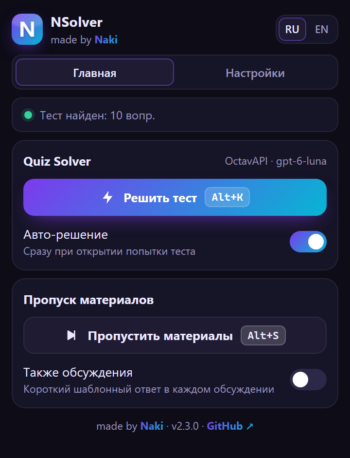
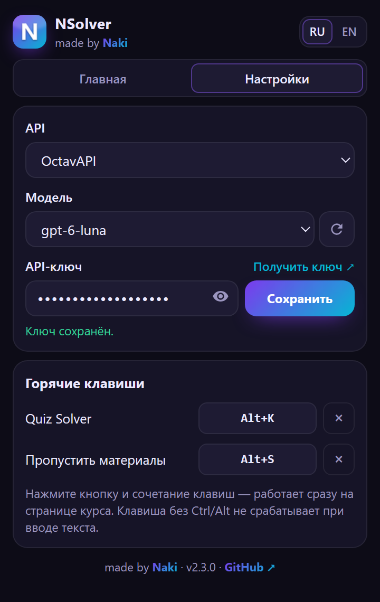
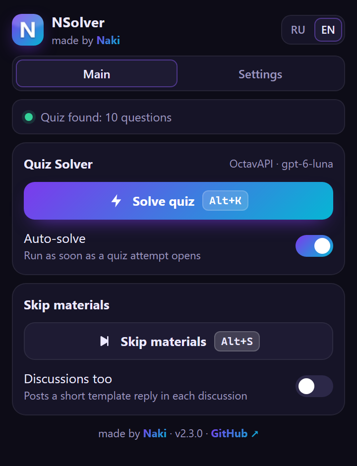

<div align="center">


# NSolver: Coursera & NetAcad Solver / AutoPass

Расширение для Chrome, которое решает тесты Coursera и Cisco NetAcad с помощью ИИ и отмечает лекции и материалы Coursera пройденными.

**made by [Naki](https://github.com/Naki-404/NSolver)** · Manifest V3 · v2.15.0 · [English](#english)

</div>

---

<p align="center">
  
  &nbsp;&nbsp;
  
</p>

## Возможности

- **Quiz Solver.** Берёт вопросы открытой попытки теста, отправляет их выбранной модели и сам отмечает ответы: одиночный выбор, несколько вариантов (checkbox) и текстовые поля.
- **Материалы курса.** В запрос к модели добавляются подходящие фрагменты самого курса: на Coursera — лекций и чтений, на NetAcad — страниц модулей. Ответы совпадают с тем, чему учит курс. Материалы хранятся в браузере (срок обновления в днях задаётся в настройках); их можно смотреть и править в «Базе материалов» (Настройки → Открыть базу), добавлять свои заметки.
- **Авто-решение.** Тест решается сразу при открытии попытки, без нажатий.
- **Cisco NetAcad.** NSolver читает текст вопросов прямо со страницы курса (включая фреймы и Shadow DOM), отправляет модели только текст и сам отмечает ответы: один или несколько вариантов, выпадающие списки, текстовые поля. Запуск: плавающая кнопка **Решить**, `Alt+K` или кнопка в окне расширения.
- **Пропуск материалов.** Coursera: отмечает лекции, материалы для чтения, Dialogue и Role Play пройденными, по желанию отвечает в обсуждениях (только в непройденных). NetAcad: проходит весь курс, все модули подряд, примерно за минуту (экзамены и тесты не трогает).
- **Автосолвер квизов.** Одна кнопка проходит весь курс: открывает модули по очереди, решает и отправляет то, что идёт в оценку (практику пропускает), при неудаче пересдаёт (2 или 3 раза — на ваш выбор). NetAcad: ответы из данных курса, экзамены не трогает. Coursera: ответы модели, Honor Code отмечает сам.
- **Programming assignments на Coursera (Jupyter).** Пишет код ячеек с заданиями, прогоняет ноутбук, исправляет ошибки по тестам и нажимает Submit Assignment.
- **Автопроход курсов.** В настройках список ссылок на курсы или специализации Coursera: NSolver сам записывается (только бесплатно), засчитывает материалы и проходит все оцениваемые задания, курс за курсом.
- **Peer review на Coursera.** Пишет и сдаёт работу (текст или файлы DOCX/PDF по частям задания, с таблицами и графиками), затем проверяет нужное число работ однокурсников по рубрике, читая их текст и приложенные PDF / DOCX.
- **Четыре API на выбор:** OctavAPI, Claude API, ChatGPT API и Gemini API. Для каждого хранится свой ключ и своя модель.
- **Актуальный список моделей.** После сохранения ключа подтягивается полный список моделей прямо из API.
- **Горячие клавиши.** Назначаются прямо в расширении и сразу работают на странице курса. По умолчанию Quiz Solver запускается по `Alt+K`.
- **Интерфейс на RU / EN.**

## Установка

1. Скачайте репозиторий: **Code → Download ZIP** и распакуйте архив. Или клонируйте:
   ```bash
   git clone https://github.com/Naki-404/NSolver.git
   ```
2. Откройте `chrome://extensions` (в Edge `edge://extensions`, в Яндекс Браузере `browser://extensions`).
3. Включите **Режим разработчика** (переключатель в правом верхнем углу).
4. Нажмите **Загрузить распакованное расширение** и выберите папку `NSolver` (ту, где лежит `manifest.json`).
5. Закрепите иконку NSolver на панели браузера через значок пазла.

Нужен Chrome 116 или новее либо другой браузер на Chromium той же версии.

## Быстрый старт

1. Нажмите на иконку NSolver и откройте вкладку **Настройки**.
2. Выберите **API** и вставьте ключ. Ссылка «Получить ключ ↗» ведёт на страницу ключей выбранного провайдера.
3. Нажмите **Сохранить**. Расширение проверит ключ и загрузит список моделей.
4. Выберите модель.
5. Откройте тест на Coursera и нажмите **Start** или **Resume**.
6. Нажмите `Alt+K` или кнопку **Решить тест**. Ответы проставятся сами, справа вверху появится уведомление `Naki: Готово…`.
7. **Проверьте ответы и отправьте тест сами.** Расширение тест не отправляет.

Подробное руководство: **[docs/USAGE.md](docs/USAGE.md)**.

### Cisco NetAcad

1. Откройте тест или страницу модуля с вопросами на netacad.com.
2. Нажмите плавающую кнопку **Решить**, `Alt+K` или **Решить тест** в окне расширения.
3. NSolver отметит ответы на всех неотвеченных вопросах страницы и подсветит их зелёной рамкой. Если какой-то вопрос отметить не удалось, его ответ будет в карточке справа внизу.
4. **Проверьте ответы и нажмите Submit сами.**

**Пропустить материалы** (в окне расширения или назначенный хоткей) проходит все модули курса: видео, текст, вкладки, анимации. Экзамены не открываются.

## Провайдеры

| API | Где взять ключ | Модель по умолчанию |
|---|---|---|
| OctavAPI | [octavapi.shop](https://octavapi.shop) | `gpt-6-luna` |
| Claude API | [console.anthropic.com](https://console.anthropic.com/settings/keys) | `claude-opus-5-5` |
| ChatGPT API | [platform.openai.com](https://platform.openai.com/api-keys) | `gpt-5.5` |
| Gemini API | [aistudio.google.com](https://aistudio.google.com/app/apikey) | `gemini-3.8-flash` |

Кнопка ↻ рядом с моделью обновляет список с API. Пункт «✎ Другая модель…» позволяет вписать ID модели вручную.

## Горячие клавиши

| Действие | По умолчанию |
|---|---|
| Quiz Solver / решение на NetAcad | `Alt+K` |
| Пропустить материалы | не назначено |

Чтобы поменять: **Настройки → Горячие клавиши**, нажмите на кнопку сочетания и затем нужные клавиши. `Esc` отменяет запись, `×` сбрасывает. Сочетание без Ctrl/Alt (например, просто `K`) не срабатывает, пока вы печатаете в поле ввода.

## Частые проблемы

- **«Вопросы теста не найдены».** Откройте именно попытку теста (Start/Resume) и обновите страницу.
- **Хоткей не срабатывает.** Кликните по странице курса, чтобы фокус был на ней, и обновите вкладку после переустановки расширения.
- **«Неверный или неактивный API-ключ».** Проверьте ключ и баланс у провайдера.
- **Часть ответов не проставилась.** В уведомлении будут номера вопросов: проверьте их вручную.
- **NetAcad не распознаётся (кнопки «Решить» нет, статус «Откройте курс…»).** После обновления файлов перезагрузите расширение кнопкой ↻ на `chrome://extensions` (Opera / Opera GX: `opera://extensions`) и обновите вкладку NetAcad. Внизу окна NSolver должна быть новая версия.
- **NetAcad: «На странице нет неотвеченных вопросов».** Откройте сам тест (страницу с вариантами ответов). Уже отправленные вопросы NSolver не трогает.

Больше решений: [docs/USAGE.md#частые-проблемы](docs/USAGE.md#частые-проблемы).

## Приватность

- API-ключи хранятся только в вашем браузере (`chrome.storage.local`).
- Текст вопросов отправляется только выбранному вами API. Других серверов у расширения нет.
- Запросы к Coursera идут от вашей сессии на coursera.org, как обычные действия на сайте.

## Важно

- Ответы ИИ могут быть неверными. Проверяйте их перед отправкой.
- Автоматическое прохождение оцениваемых заданий может нарушать [Honor Code Coursera](https://www.coursera.org/about/terms/honorcode). За использование расширения отвечаете вы сами.
- Новые курсы могут блокировать автоматическую отметку материалов.

## Структура проекта

```
NSolver/
├── manifest.json        # описание расширения (Manifest V3)
├── background.js        # прокси к AI API, хоткеи из фреймов NetAcad, подключение к открытым вкладкам
├── interceptor.js       # перехват ответов Coursera на странице (MAIN world)
├── content.js           # Coursera: Quiz Solver, пропуск материалов, автосолвер, peer review, хоткеи, уведомления
├── labs.js, labs-main.js # Coursera Labs (Jupyter): код заданий, прогон ноутбука, Submit Assignment
├── materials-core.js    # база материалов: хранение и подбор фрагментов (BM25) для Coursera и NetAcad
├── file-text.js         # peer review: текст из PDF/DOCX/PPTX, создание PDF/DOCX/TXT
├── netacad.js           # Cisco NetAcad: вопросы из DOM, автоответы, пропуск курса, кнопка, хоткеи
├── netacad-main.js      # NetAcad, мир страницы: материалы и квизы модуля через движок курса (Adapt)
├── model-provider.js    # запросы к OctavAPI / Claude / ChatGPT / Gemini
├── shared.js            # настройки, хоткеи, переводы RU/EN
├── popup.html           # окно расширения
├── materials.html/.js/.css # база материалов курсов: просмотр, правка, заметки, экспорт/импорт
├── panel.js, panel.css  # интерфейс окна
├── images/              # иконки
└── docs/                # руководство и скриншоты
```

История версий: [CHANGELOG.md](CHANGELOG.md).

---

## English

**NSolver: Coursera & NetAcad Solver / AutoPass** is a Chrome extension (Manifest V3) made by [Naki](https://github.com/Naki-404/NSolver). It solves Coursera and Cisco NetAcad quizzes with AI and marks Coursera lectures and readings as completed.

<p align="center"></p>

**Features:** quiz solver for single choice, multiple choice and text answers; auto-solve when an attempt opens; Cisco NetAcad mode that reads the questions as text from the course page and selects the answers itself (floating **Solve** button, `Alt+K` or the popup button); skip materials (Coursera: lectures and readings, optionally discussions; NetAcad: every module of the course in about a minute, exams left alone); four providers (OctavAPI, Claude API, ChatGPT API, Gemini API) with a live model list from the API; a quiz autopilot that goes through every module and submits the graded work only (NetAcad answers from the course data, Coursera answers from the model; optional automatic retakes); Coursera peer-reviewed assignments (writes and submits the work as text or a PDF, then reviews the required number of classmates by the rubric); a materials base of course texts for Coursera and NetAcad that goes into the prompt; in-extension hotkeys (`Alt+K` by default); RU / EN interface.

**Install:** download the ZIP or `git clone`, open `chrome://extensions`, turn on Developer mode, click **Load unpacked** and select the `NSolver` folder.

**Use:** Settings → choose an API, paste a key, **Save**, pick a model. Open a Coursera quiz attempt and press `Alt+K` or **Solve quiz**. Review the answers and submit yourself. On NetAcad, open the quiz and press the floating **Solve** button or `Alt+K`.

**Privacy:** settings and keys stay in `chrome.storage.local`; only the question text (and course excerpts) goes to the API you selected.

**Note:** AI answers can be wrong. Automated completion of graded work may violate the Coursera Honor Code. Use at your own risk.

Full guide (Russian): [docs/USAGE.md](docs/USAGE.md).
